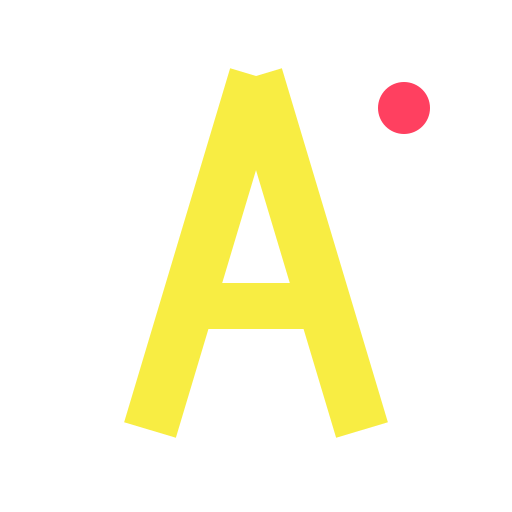

<p align="center">
  
</p>

# AlucardiosDataBase

**Tu biblioteca de juegos de MEGA, por fin con pinta de colección.**

AlucardiosDataBase es un catálogo web autohospedado para una biblioteca de
Nintendo Switch guardada en MEGA. Lee un volcado de MEGAcmd, enriquece cada
título con metadatos de IGDB y ofrece una interfaz rápida y editorial para
explorar, buscar, consultar y decidir qué jugar después.

**No es un lanzador de juegos, un repositorio de ROMs ni un servicio de
descargas.** No incluye archivos de juegos; organiza una biblioteca que ya
tienes y controlas.

[English](README.md) · [Guía de operaciones](docs/OPERACIONES.md) · [Contribuir](CONTRIBUTING.md)

[](LICENSE)
[](backend/pyproject.toml)
[](frontend/package.json)
[](docker-compose.yaml)
[](.github/workflows/ci.yml)

## Qué te llevas

- **Una biblioteca con aspecto de colección.** Explora una lista tipográfica o
  una cuadrícula de carátulas 2:3, con búsqueda, filtros por letra, ordenación
  y paginación.
- **Todo sobre un juego en un solo sitio.** Carátulas de IGDB, sinopsis,
  géneros, plataformas, fechas, capturas y enlaces externos; además de los
  archivos y versiones reales que hay en tu árbol de MEGA.
- **Un estante retro aparte.** Las ROMs de arcade, consolas y microordenadores
  viven en su propio catálogo y su propia base de datos, sin mezclarse con
  Switch.
- **Novedades que significan algo.** Una vista dedicada a los juegos recién
  añadidos y a las actualizaciones o DLC que acaban de entrar.
- **Cómoda en cualquier pantalla.** Web SSR responsive, instalable como PWA y
  con tintas claras y oscuras.
- **Pensada para teclado.** Foco visible, anillo de selección accesible en la
  cuadrícula y una barra de acento discreta en la lista; respeta el movimiento
  reducido.
- **Autohospedada de verdad.** Tu biblioteca, tu cuenta de MEGA, tu máquina.
  Aquí no se crea ninguna cuenta ni se sube tu biblioteca a un tercero.

## Qué no es

- **No es una fuente de juegos.** El repositorio solo contiene código y
  configuración. El volcado de MEGA, la base de datos, las carátulas y las
  exportaciones son artefactos locales.
- **No es una web pública de streaming o descargas.** No hay demo pública: la
  aplicación está pensada para servir una biblioteca privada que tú controlas.
- **No es un emulador ni un lanzador.** Abre fichas de catálogo, no juegos.
- **No es un lugar para credenciales.** Las contraseñas, tokens y sesiones de
  MEGA se quedan en el host, fuera del repositorio y fuera de la base de datos.

## Un vistazo rápido

| Ruta | Qué encontrarás |
| --- | --- |
| `/` | La biblioteca de Switch: lista o cuadrícula, búsqueda, filtros, orden y paginación |
| `/game/:slug` | La ficha completa: carátula, sinopsis, metadatos, versiones, archivos y enlaces |
| `/novedades` | Juegos nuevos y actualizaciones/DLC detectados en el último volcado |
| `/retro` | La colección retro independiente |
| `/actualizar` | La pantalla guiada de actualización de MEGA en un host con MEGAcmd y el agente |

La interfaz se acerca más a un catálogo editorial que a una copia de una
consola. Primero están la identidad de Alucardio, la tipografía, el grano de
papel y las tintas; los pequeños detalles de selección inspirados en consola
son solo acentos.

## Arranque rápido con Docker

### Qué necesitas

- Docker Engine con Docker Compose.
- Una cuenta de MEGA que contenga **tu propia** biblioteca.
- [MEGAcmd](https://mega.io/cmd) en el host para generar el volcado. Los
  contenedores no pueden ejecutar MEGAcmd ni iniciar sesión en MEGA por ti.
- Credenciales de IGDB/Twitch si quieres carátulas y metadatos enriquecidos.

### Levanta el stack

```bash
git clone https://github.com/Chreesthian/AlucardiosDataBase.git
cd AlucardiosDataBase
cp .env.example .env
# Opcional: añade tus credenciales IGDB en .env o backend/.env
docker compose up -d --build
```

Abre **http://localhost:7330**. La API y su documentación interactiva están en
`http://localhost:7331` y `http://localhost:7331/docs`.

El stack espera un volcado canónico en `./mega_cuenta_contenido_MEGAcmd.txt`
(se monta en solo lectura). Genéralo o refréscalo desde el host con tu sesión
de MEGAcmd; el flujo completo está en la
[guía de operaciones](docs/OPERACIONES.md).

### Primera carga de la biblioteca

```bash
make credenciales   # guarda fuera del repo la cuenta MEGA de la semana
make volcado        # refresca el volcado y aplica el escaneo incremental
```

Después abre la web. En un host de escritorio con MEGAcmd, `/actualizar` puede
guiarte por el mismo proceso desde el navegador. Ninguna contraseña de MEGA se
guarda en SQLite, se devuelve por la API ni se escribe en el log.

## Privacidad y seguridad

- Las credenciales de MEGA se leen de archivos privados fuera del repositorio
  (`~/.config/alucard/mega.env`, `chmod 600`).
- Los contenedores reciben el volcado y la configuración mínima; nunca reciben
  la contraseña de MEGA.
- `.env`, las bases de datos, los volcados y las exportaciones están ignorados
  por Git.
- El agente de actualización usa un socket Unix protegido por token.
- Este repositorio no distribuye archivos de juegos ni binarios con derechos
  de autor.

## Desarrollo

Requisitos: Python 3.11+, [uv](https://docs.astral.sh/uv/), Node.js 22+ y
[pnpm](https://pnpm.io/).

```bash
# Backend
cd backend
uv sync
uv run pytest

# Frontend
cd ../frontend
pnpm install
pnpm dev
```

La auditoría Playwright vive en `e2e/` y espera el stack levantado:

```bash
cd e2e
pnpm install
pnpm exec playwright install chromium
pnpm test
```

## Documentación

- [Guía de operaciones](docs/OPERACIONES.md) — despliegue, rotación de MEGA,
  workers, enriquecimiento IGDB, colección retro y flujos del Makefile.
- [Operations guide in English](docs/OPERATIONS.md).
- [Hoja de ruta y arquitectura](docs/PLAN.md).
- [Investigación de auditoría de versiones](docs/INVESTIGACION_VERSIONES.md).
- [Contribuir](CONTRIBUTING.md) / [Código de conducta](CODE_OF_CONDUCT.md).
- [Política de seguridad](SECURITY.md) / [Instrucciones para agentes de IA](AGENTS.md).
- [Registro de cambios](CHANGELOG.md).

## Licencia

[MIT](LICENSE). Úsalo, adáptalo y mejóralo. El proyecto no concede ningún
derecho sobre los juegos, carátulas u otros contenidos de terceros de tu
biblioteca.
